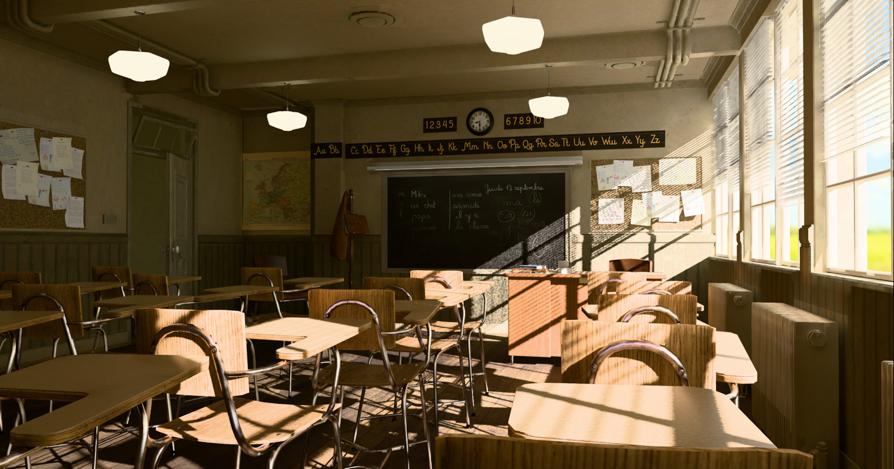
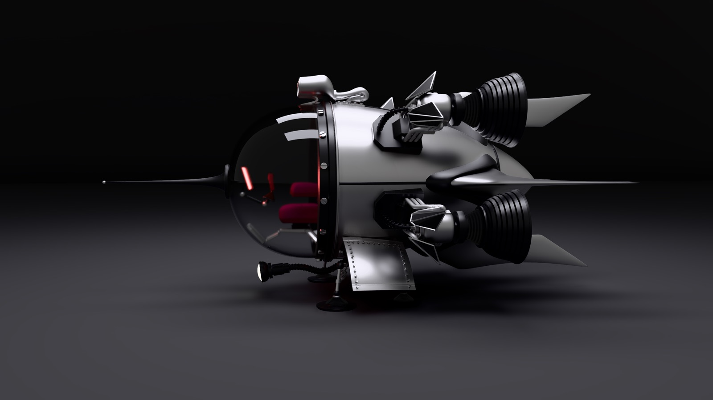
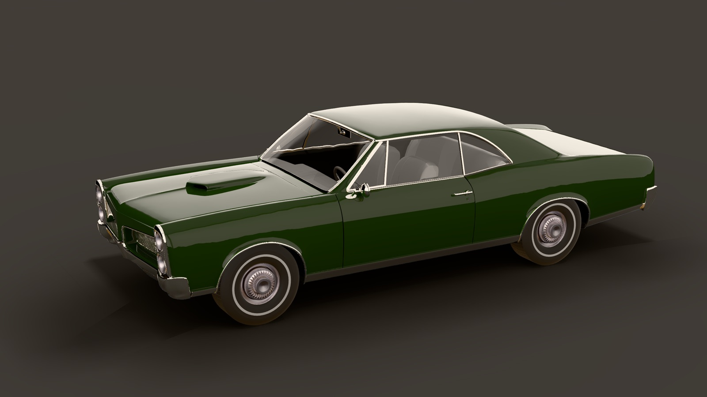

# speedo

[](https://github.com/djohansson/speedo/actions/workflows/ci.yml)

<!-- a platform's badge takes .github/workflows/ci.yml's job by its name (its builds and checks), a backend's the check run of its visual checks on that platform, on the driver or gpu named: a cpu driver's, or the macOS runner's paravirtual gpu (see "CI" in docs/notes/build.md) -->

| Platform | Backends |
| --- | --- |
| [](https://github.com/djohansson/speedo/actions/workflows/ci.yml?query=branch%3Amaster) | [](https://github.com/djohansson/speedo/actions/workflows/ci.yml?query=branch%3Amaster) [](https://github.com/djohansson/speedo/actions/workflows/ci.yml?query=branch%3Amaster) |
| [](https://github.com/djohansson/speedo/actions/workflows/ci.yml?query=branch%3Amaster) | [](https://github.com/djohansson/speedo/actions/workflows/ci.yml?query=branch%3Amaster) [](https://github.com/djohansson/speedo/actions/workflows/ci.yml?query=branch%3Amaster) |
| [](https://github.com/djohansson/speedo/actions/workflows/ci.yml?query=branch%3Amaster) | [](https://github.com/djohansson/speedo/actions/workflows/ci.yml?query=branch%3Amaster) |


speedo is a real-time renderer that produces physically based images at interactive frame rates. It runs on macOS (Apple silicon), Windows (x64) and Linux (x64), on Vulkan, Metal and D3D12, and is built with the same LLVM toolchain and libc++ on all three. It renders with or without hardware ray tracing, and without a display or a GPU, which is how CI tests it.

<!-- one row, the same height: each image's width in proportion to its aspect ratio (1.90, 1.78, 1.78, 1.00) -->
<p align="center">
  <a href="docs/screenshots/classroom2.jpg"></a>
  <a href="docs/screenshots/spaceship.jpg"></a>
  <a href="docs/screenshots/pontiac-gto.jpg"></a>
  <a href="docs/screenshots/bathroom.jpg"></a>
</p>

*Five scenes of the [glTF research set](https://github.com/ErfanMo77/gltf-research-scenes) (CC0): glass-of-water (top), classroom2, spaceship, pontiac-gto and bathroom, each from its own camera in the lighting its file describes, with hardware ray tracing, indirect lighting and ray traced shadows, reflections and refractions.*

<!-- made with the profile client on Metal with hardware ray queries (Apple M4 Pro), each scene as the client opens it (the file's camera, its conversion.yaml's environment and exposure, PBR Neutral): SPEEDO_GRAPHICS_API=metal SPEEDO_RAY_QUERY=1 SPEEDO_HEADLESS=1 SPEEDO_UI=0 SPEEDO_REPEATABLE=1 SPEEDO_TIME_FRAME_SECONDS=0.0166667 SPEEDO_MOTION_BLUR=0 SPEEDO_GRAIN=0 SPEEDO_UPSCALING=native SPEEDO_AUTOLOAD_EXIT=1500 SPEEDO_CAPTURE=<file.bmp>, SPEEDO_WINDOW_SIZE twice the reference render's size (2560x1440; classroom2 2880x1514, bathroom 2048x2048), scaled to 1600 wide. Models under test-assets/ (resources/): gltf-research-scenes/scenes/gltf_research_scenes_glb/gltf_research_scenes/scenes/<scene>/gltf/<scene>_extended.glb (glass_of_water_extended.glb, classroom2.glb, spaceship_extended.glb, pontiac_gto_extended.glb, bathroom_extended.glb). -->

Every scene of the set against its path traced reference, with the platform it was made on: [the chart](docs/research-scenes/overview.jpg) and [its measures](docs/research-scenes/overview.md) (docs/research-scenes-plan.md).

## Features

- **Assets:** glTF 2.0 with the `KHR_materials_*` extensions the Khronos samples use, material variants, Draco and meshopt compression, KTX2/Basis and WebP textures, skinning, morph targets and `KHR_animation_pointer`; Wavefront OBJ; zip archives; HDR panoramas. [assets](docs/notes/assets.md)
- **Lighting:** physically based materials, clustered lights, a cached shadow atlas, emissive surfaces as area lights, and indirect lighting from irradiance probes over a voxel clipmap with a surface cache and a ray traced near field. [rendering](docs/notes/rendering.md), [indirect lighting](docs/notes/indirect-lighting.md)
- **Ray tracing:** soft shadows, glossy reflections, refraction through glass and caustics. Rays are traced with hardware ray queries where the device has them, or in software through BVHs on the GPU; every ray traced feature works either way, with smaller budgets in software. The choice can be changed while the client runs. On macOS software tracing is the default, as Metal's ray tracing can restart the GPU. [rendering](docs/notes/rendering.md)
- **Rendering:** a frame graph, a visibility buffer, GPU culling with two-phase occlusion, order independent transparency, transmission, subsurface scattering, reversed depth, and up to four views in split screen. [rendering](docs/notes/rendering.md)
- **Camera:** physical exposure with auto exposure, lens models with vignetting, aberrations, distortion and glare (including anamorphic lenses), depth of field, motion blur, film grain, and temporal upscaling with a port of AMD FSR 3.1. [rendering](docs/notes/rendering.md)
- **Sky:** a physical atmosphere, the sun, moon and stars positioned by date and time of day, aerial perspective and fog. [sky](docs/notes/sky.md)
- **Engine:** a task-based executor; Vulkan 1.4 on all platforms, Metal on macOS and D3D12 on Windows, behind one rendering hardware interface; shaders in Slang, compiled in parallel worker processes, cached, and reloaded while the client runs; crash reports with GPU breadcrumbs; a headless mode. [core](docs/notes/core.md), [layering](docs/notes/layering.md), [rhi](docs/notes/rhi.md)
- **Testing:** importer checks against reference decodes, the client run over the test sets under graphics API validation, and image checks against references, known answers and path traced renders, run by CI on every push. [visual testing](docs/visual-testing-plan.md), [assets](docs/notes/assets.md)

## Installing

Each GitHub release has an installer per platform with its sha256: a `.dmg` for macOS on Apple silicon, an `.msi` for Windows x64 (AVX2), and an AppImage for Linux x64 (AVX2, glibc 2.43 or newer, as on Ubuntu 26.04). The installers are not signed yet: on macOS use System Settings > Privacy & Security > Open Anyway (or `xattr -dr com.apple.quarantine /Applications/Speedo.app`), on Windows SmartScreen's More info > Run anyway. The first launch offers to download the test models. Installed clients ship precompiled shaders and no shader compiler; on macOS the Vulkan driver is bundled.

## Using the client

- **File > Open...** opens models, zip archives, panoramas and images from a file browser with thumbnails and previews, one file or several side by side.
- **Navigation:** drag with the left mouse button to look around, `W`/`A`/`S`/`D` to move, the scroll wheel to change the speed. `Alt+Enter` toggles fullscreen.
- **The interface** fades when not in use; move the mouse to the top of the window to bring back the menu bar.
- **View** holds the settings: layout, presentation, scene, animation, environment and time of day, units, the cameras and lens, the lights, the rendering features (with the Ray Tracing and Global Illumination windows), tonemapping, upscaling, debug views and statistics.
- **Edit > Copy Scene** (`Ctrl/Cmd+Shift+C`) copies the camera and every changed setting as environment variables, which start the client in the same state; Paste Scene applies them to a running client. Use it to report what you see.

## Building from source

### 1. Set up the machine

Run the bootstrap script for your platform from the repository root:

| Platform | Command |
|----------|---------|
| macOS    | `./setup_osx.sh` |
| Linux    | `./setup_linux.sh` |
| Windows  | `setup_windows.bat` |

The bootstrap script installs PowerShell 7.5+ if needed and runs `setup.ps1`. Setup installs the platform SDK the toolchain builds against (the Xcode Command Line Tools, Visual Studio's C++ build tools and the Windows SDK, or `build-essential`), CMake and a few packages, the pinned vcpkg release, and every dependency, including the LLVM toolchain, from the project's public binary cache. A package the cache lacks is built locally. It also generates `CMakeUserPresets.json` and the VS Code launch and task configurations. Re-run it after OS or SDK updates. See [build](docs/notes/build.md).

### 2. Configure and build

Build directories come from presets named `<triplet>-<config>`, e.g. `arm64-osx-clang-profile`, `x64-windows-clang-profile` or `x64-linux-clang-profile`:

| Config    | Use |
|-----------|-----|
| `debug`   | Debugging, with graphics API validation and asserts. Slow. |
| `profile` | Optimized, with Tracy, GPU pass timings and asserts. The default for development and testing. |
| `release` | Optimized, without profiling. What the installers ship. |
| `sanitize` | `profile` with AddressSanitizer and UndefinedBehaviorSanitizer (macOS and Linux). |
| `tsan`    | `profile` with ThreadSanitizer (macOS and Linux). |

```sh
cmake --preset arm64-osx-clang-profile && cmake --build build/arm64-osx-clang-profile
```

Always configure with `cmake --preset <name>` before building: the presets carry the toolchain environment that the dependencies' hashes depend on, and a configure without it stops with an error. In VS Code, CMake Tools picks up the presets and the generated launch configurations start the client, the server or Tracy. Builds use FASTBuild with a shared object cache, and target a fixed CPU baseline (Apple M1, x86-64-v3) so that builds are portable between machines.

### 3. Run the client

Run `client` from the repository root, where it finds `resources/`:

```sh
./build/arm64-osx-clang-profile/client
```

| Option | Default |
|--------|---------|
| `-r <dir>`: resource directory (fonts, shaders, test assets) | `resources/` |
| `-u <dir>`: user profile directory (settings, caches, logs) | `.speedo/` |

The default graphics API is Vulkan on Windows and Linux and Metal on macOS; `SPEEDO_GRAPHICS_API=vulkan|metal|d3d12` selects another, and File > About Speedo... shows the one in use. From a checkout, shaders are compiled at startup in worker processes and cached; later launches start in seconds.

For Vulkan on macOS, point the loader at the KosmicKrisp driver that setup installs:

```sh
export VK_DRIVER_FILES=$(ls $PWD/install/*/share/vulkan/icd.d/kosmickrisp_mesa_icd.*.json | head -1)
```

On Windows and Linux Vulkan uses the system's driver. To render on the CPU, select lavapipe the same way (`install/<host triplet>/share/vulkan/icd.d/lvp_icd.*.json`). For a debug build from a shell, set `VK_LAYER_PATH=$PWD/install/<triplet>/share/vulkan/explicit_layer.d` to find the validation layers; the VS Code launch configurations do this. `SPEEDO_HEADLESS=1` runs without a window, rendering into an image that `SPEEDO_CAPTURE` saves.

### Programs

All built into the preset's build directory and run from the repository root:

| Program | Purpose |
|---------|---------|
| `client` | The viewer: one to four views of the scene and tools to inspect it. |
| `server` | A companion process the client talks to over ZeroMQ; the start of a distributed task system. |
| `assettest` | Imports models, images and environments and checks the results, the BVHs and the lens prescriptions. |
| `rhitest` | Checks each graphics backend's compute, images, draws and blits against each other. |
| `imagecompare` | Compares a capture with a reference; what the visual checks pass or fail by. |
| `convergence` | Measures how long a still view's lighting takes to settle, from a series of captures. |
| `filebench`, `taskbench`, `neuralbench` | Benchmarks of file reading and importing, the task system, and a neural radiance cache's compute. |
| `shaderprecompile` | Compiles every shader variant into the precompiled sets the installers ship. |
| `shadercompileworker` | The worker process the shader compiler runs compiles in. |

## Testing

The test sets (Morgan McGuire's Computer Graphics Archive, Khronos glTF-Sample-Assets and glTF-Sample-Environments, and the glTF research scenes) are downloaded by `scripts/fetch-test-assets.ps1` into `resources/test-assets/`, pinned and checksummed. `scripts/assettest.ps1` runs `assettest` over them and, with `-Client`, opens each model in the client on each of the platform's graphics APIs, failing on load errors, asserts and validation messages:

```sh
pwsh -Command '$p = & scripts/fetch-test-assets.ps1 -Quick; & scripts/assettest.ps1 -Preset arm64-osx-clang-profile -Client -Validate -Headless -Work <work dir> @p'
```

`-Quick` selects a model or two per feature; without it, the full sets. `scripts/visualtest.ps1 -Preset <preset>` renders scenes repeatably and compares them with `imagecompare` against references, known answers and path traced renders. See [visual testing](docs/visual-testing-plan.md) and [assets](docs/notes/assets.md).

CI runs on every push to `master` and on pull requests, on GitHub's hosted runners without GPUs: each platform builds the debug, profile and release configurations and runs the importer checks and the visual checks, on lavapipe (Vulkan), WARP (D3D12) and the macOS runner's paravirtual GPU (Metal). See [build](docs/notes/build.md) ("CI").

[Environment variables](docs/environment-variables.md) start the client in a known state (model, camera, settings, a capture and an exit) and control the renderer's tuning and diagnostics.

## Profiling

Debug and profile builds are instrumented with [Tracy](https://github.com/wolfpld/tracy). Start the profiler from `install/<triplet>/tools/tracy/` or its VS Code launch configuration, then the client. GPU passes appear as zones, from the same timestamps as View > Statistics.

## Releasing

`scripts/release.ps1 -Bump patch|minor|major` (or `-Version <x.y.z>`) raises the version in `src/version.h`, commits it and tags `v<version>` on a clean `master`; `-Push` pushes both. The tag starts the release workflow, which builds and packages each platform and attaches the installers to a draft release, published by hand. `scripts/package.ps1` builds the local platform's installer from a release build. See [build](docs/notes/build.md) ("Releases").

## Documentation

| Document | Contents |
|----------|----------|
| [docs/notes/](docs/notes/) | The subsystems: [core](docs/notes/core.md), [layering](docs/notes/layering.md), [rhi](docs/notes/rhi.md), [rendering](docs/notes/rendering.md), [indirect lighting](docs/notes/indirect-lighting.md), [sky](docs/notes/sky.md), [assets](docs/notes/assets.md), [build](docs/notes/build.md). |
| [docs/environment-variables.md](docs/environment-variables.md) | Every environment variable the client, scripts and build read. |
| [docs/visual-testing-plan.md](docs/visual-testing-plan.md) | How the rendered images are checked. |
| [docs/performance-plan.md](docs/performance-plan.md) | How frame times and the lighting's convergence are measured. |
| [docs/backlog.md](docs/backlog.md) | Open work. |
| [CLAUDE.md](CLAUDE.md) | Conventions and workflow rules for contributors and AI agents. |

## Repository layout

| Path | Contents |
|------|----------|
| `src/core` | Task executor, memory pools, files, math, the application base. |
| `src/platform` | Windows (and headless), presentation, imgui's platform side. |
| `src/rhi` | The rendering hardware interface over Vulkan, Metal and D3D12. |
| `src/gfx` | Importers, scene, renderer, frame graph and the Slang shaders. |
| `src/client`, `src/server` | The two applications. |
| `src/tools` | Test tools, benchmarks, the shader tools, and Metal repros (`src/tools/macos`). |
| `scripts/` | Setup, test, asset, cache, packaging and release scripts (PowerShell), CMake toolchains and vcpkg triplets. |
| `.github/workflows/` | CI, and the release workflow on `v*` tags. |
| `ports/` | vcpkg overlay ports: patched dependencies, mesa's Vulkan drivers, FASTBuild's cache plugin. |
| `resources/` | Fonts and hand-made test models; downloaded test assets go here. |
