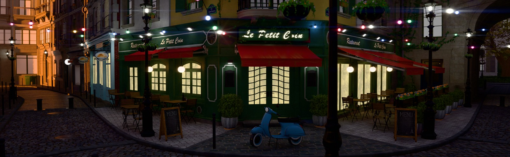

# speedo

[](https://github.com/djohansson/speedo/actions/workflows/ci.yml)

speedo is a real-time renderer built on Vulkan 1.4 for physically based images at interactive frame rates.

Light bounces through the scene from irradiance probes over a voxel clipmap, sharpened by a surface cache and a ray traced
near field, and every emissive surface lights its surroundings as an area light. Hardware ray queries trace soft shadows
from lights with a real size, glossy reflections, refraction through glass, and caustics; where a GPU has no ray tracing
hardware (and on macOS by default), BVHs on the GPU take their place. The sky is Earth's atmosphere, with the sun, moon and stars where the date and
time of day put them, aerial perspective and fog.

You see it all through a camera modeled on a real one: a physical sensor and exposure, lenses designed element by element
with their aberrations, distortion, ghosts and glare (anamorphic ones too), depth of field, motion blur and film grain,
and temporal upscaling by a port of AMD's FSR 3.1. Underneath are a visibility buffer, GPU culling with two-phase
occlusion, clustered lighting, order independent transparency, transmission and subsurface scattering, all scheduled by a
frame graph on a task based engine.

It runs on macOS (Apple silicon, through KosmicKrisp or MoltenVK), Windows and Linux, built with the same LLVM toolchain
on all three.





*The Khronos glTF sample model DragonAttenuation, Bistro (Amazon Lumberyard, from Morgan McGuire's Computer Graphics
Archive), and the Khronos glTF sample models ABeautifulGame, Sponza and CarConcept, under the physical sky at their times of day, with indirect
lighting and ray traced shadows, reflections and refractions.*

<!-- made with the profile client from View > Camera > Copy Pose's variables, SPEEDO_YEAR=2026 SPEEDO_GI=1, plus
SPEEDO_WINDOW_SIZE=3022x1898 SPEEDO_UI=0 SPEEDO_AUTOLOAD_EXIT=1200 SPEEDO_CAPTURE=<file.bmp>; the letterbox cropped, and
scaled to 1600 wide. Models under test-assets/ (resources/): mcguire/bistro/Exterior/exterior.obj,
glTF-Sample-Assets/Models/<model>/... (ABeautifulGame/glTF-Binary-KTX-ETC1S-Draco, DragonAttenuation/glTF-Binary,
Sponza/glTF, CarConcept/GLB).
Bistro: SPEEDO_CAMERA=-1357.6443,247.9254,232.3015,1.807,73.154 SPEEDO_TIME_OF_DAY=19.720 SPEEDO_UNITS=cm
SPEEDO_LENS=anamorphic-50 SPEEDO_FOCUS=wide
ABeautifulGame: SPEEDO_CAMERA=0.0343,0.1526,0.2572,10.550,-3.884 SPEEDO_TIME_OF_DAY=10.500 SPEEDO_LENS=anamorphic-50
DragonAttenuation: SPEEDO_CAMERA=1.3303,1.0941,2.5190,3.171,-30.950 SPEEDO_AUTOLOAD_VARIANT=0 SPEEDO_TIME_OF_DAY=19.720
SPEEDO_LENS=anamorphic-50 SPEEDO_FOCUS=wide
Sponza: SPEEDO_CAMERA=6.1378,4.2769,-2.4115,-18.428,-104.616 SPEEDO_TIME_OF_DAY=14.440 SPEEDO_LENS=ultrawide-16
SPEEDO_FOCUS=wide
CarConcept: SPEEDO_CAMERA=2.5407,0.6069,0.7475,9.462,-58.063 SPEEDO_AUTOLOAD_VARIANTS=0,1,2 SPEEDO_TIME_OF_DAY=17.230
SPEEDO_LENS=anamorphic-50-133 SPEEDO_FOCUS=wide -->

## Features

Each links to the notes that describe it in depth: how it works, what was tried, and what it costs.

- **Assets:** glTF 2.0 with every `KHR_materials_*` extension the Khronos samples use, material variants, Draco and
  meshopt meshes, KTX2/Basis and WebP textures, skins, morph targets and `KHR_animation_pointer`; Wavefront OBJ; zip
  archives of models; HDR panoramas; a ground plane, the scene's unit. [assets](docs/notes/assets.md)
- **Indirect lighting:** irradiance probes over a voxel clipmap, a surface cache and a ray traced near field, and emissive
  surfaces lighting the scene as area lights. [indirect lighting](docs/notes/indirect-lighting.md)
- **Ray tracing,** through hardware ray queries where the device has them (else BVHs on the GPU): soft shadows from lights
  with a size, glossy reflections, refractions through glass, and caustics. On macOS the BVHs are the default and ray
  queries opt in (`SPEEDO_RAY_QUERY=1`) until Apple fixes a GPU restart in Metal's ray tracing.
  [rendering](docs/notes/rendering.md)
- **Rendering:** a frame graph, a visibility buffer, GPU culling with two-phase occlusion, clustered lighting, a cached
  shadow atlas, order independent transparency, transmission and subsurface scattering, reversed depth.
  [rendering](docs/notes/rendering.md)
- **The camera:** a physical sensor and exposure (auto exposure, by the eye at night), lenses with their vignetting,
  aberration, distortion and glare (anamorphic ones too), depth of field, motion blur and grain, and temporal upscaling by
  a port of AMD's FSR 3.1. [rendering](docs/notes/rendering.md)
- **The sky:** Earth's atmosphere, the sun, moon and stars where the time of day and the date put them, aerial perspective
  and fog. [sky](docs/notes/sky.md)
- **The engine:** a task executor, Vulkan 1.4 behind a backend-neutral abstraction, crash reports with GPU breadcrumbs.
  [layering](docs/notes/layering.md), [rhi](docs/notes/rhi.md)

## What's in the box

| Program     | What it does |
|-------------|--------------|
| `client`    | The viewer: a window with a menu bar, one to four views of the scene, and tools for inspecting it, in a translucent, frosted interface styled after macOS's. |
| `server`    | A small companion process the client talks to over ZeroMQ: the start of a distributed task system. |
| `assettest` | Imports every model, image and environment it's given and checks the results: the main automated test. |
| `filebench` | A benchmark of file reading, the importers (`--import <files>`) and zip extraction (`--zip <archives>`). |
| `shaderprecompile` | Compiles every shader variant the client may load into the precompiled sets an installer ships (run by `scripts/package.ps1`). |

### Using the client

- **File > Open...** (and Open Recent) is a file browser with thumbnails and previews of models, zip archives,
  panoramas and images. It opens one file or several, side by side or as authored.
- **Moving around:** drag with the left mouse button to look around, `W`/`A`/`S`/`D` to move, the scroll wheel for the
  move speed. `Alt+Enter` toggles fullscreen.
- **The interface fades away** when it isn't in use: move the mouse to the top of the window to bring the menu bar back.
- **View** holds the settings: the layout of views, presentation, the environment and time of day, the camera and its
  lens, the lighting features (each can be turned off to compare), debug views, and the Lights and Statistics windows.
- **View > Camera > Copy Pose** (`Ctrl/Cmd+Shift+C`) copies the camera and every changed setting as environment
  variables, which start the client in the same state, or Paste Pose applies to a running one: the way to report what
  you see.

## Installing

Each release on GitHub has an installer for every platform: a `.dmg` for macOS on Apple silicon, an `.msi` for Windows x64,
and an AppImage for Linux x64 (glibc 2.43 or newer, as on Ubuntu 26.04), each with its sha256. They aren't signed by a
developer yet, so the system asks the first time: on macOS, System Settings > Privacy & Security > Open Anyway (or
`xattr -dr com.apple.quarantine /Applications/Speedo.app`); on Windows, SmartScreen's More info > Run anyway. The first
launch offers to download the test models while the driver creates its pipelines. An installed client's shaders come
precompiled: the installers ship no shader compiler.

## Getting started

### 1. Set up the machine

Run the bootstrap script for your platform from the repository root:

| Platform | Command |
|----------|---------|
| macOS    | `./setup_osx.sh` |
| Linux    | `./setup_linux.sh` |
| Windows  | `setup_windows.bat` |

The bootstrap script installs PowerShell 7.5+ if it's missing, then hands over to `setup.ps1`. It installs the system
compilers and SDKs (the Xcode Command Line Tools on macOS, the C++ build tools and the Windows SDK on Windows, the
distribution's build packages on Linux) and the other system packages (Homebrew, apt or winget), bootstraps the `vcpkg`
submodule, and generates `CMakeUserPresets.json` and the VS Code launch and task configurations. Re-run it after OS or SDK
updates.

speedo builds with its own LLVM toolchain on every platform: clang, lld and libc++ from vcpkg's LLVM, one version
everywhere, with the system tools providing the platform's SDKs and libraries. Setup downloads the toolchain prebuilt, along with every
other dependency, from the project's shared binary cache, a public bucket read over https: for macOS 27 on Apple silicon,
Windows x64, and Linux x64 on Ubuntu 26.04. A package the cache doesn't hold yet is built locally. See
[build](docs/notes/build.md) ("vcpkg's shared binary cache").

### 2. Configure and build

Every build directory comes from a preset named `<triplet>-<config>`, e.g. `arm64-osx-clang-profile`,
`x64-windows-clang-profile` or `x64-linux-clang-profile`:

| Config    | Use it for |
|-----------|------------|
| `debug`   | Debugging. Vulkan validation and asserts are on, and it's slow. |
| `profile` | Optimized, with profiling (Tracy and GPU pass timings) and asserts. The best default for testing. |
| `release` | Optimized, without profiling (no Tracy): what the installers ship. |

```sh
cmake --preset arm64-osx-clang-profile
cmake --build build/arm64-osx-clang-profile
```

Always configure with `cmake --preset <name>` before building from a shell: the presets carry the toolchain's
environment, which the dependencies' hashes depend on. A configure without it, from a raw `cmake` command or a build
that reconfigures by itself, stops with a message telling you to run the preset. In VS Code, the CMake Tools
extension picks up the presets, and the generated launch configurations start the client, the server or the Tracy
profiler with the right environment.

### 3. Run

Run the programs from the repository root:

```sh
./build/arm64-osx-clang-profile/client
```

| Option | Default |
|--------|---------|
| `-r <dir>`: the resource directory (fonts, shaders, test assets) | `resources/` |
| `-u <dir>`: the user profile directory (settings, caches, logs) | `.speedo/` |

From a checkout the shaders compile from their sources at startup, through a shader compiler library the client loads
only for that; an installed client gets them precompiled, and its package ships neither the compiler nor slang. A first
launch compiles them in the background (from a checkout) and has the driver create the pipelines, with the progress
shown in a Loading window while the interface stays responsive; later launches take them from the profile's caches and
start in seconds.

On macOS, point the Vulkan loader at KosmicKrisp, which setup restores from the binary cache (built from the
djohansson/mesa fork, with a workaround for a GPU restart in Apple's ray tracing, see
[indirect lighting](docs/notes/indirect-lighting.md)):

```sh
export VK_DRIVER_FILES=$(ls $PWD/install/*/share/vulkan/icd.d/kosmickrisp_mesa_icd.*.json | head -1)
```

For a debug build from a shell, also set `VK_LAYER_PATH=$PWD/install/<triplet>/share/vulkan/explicit_layer.d` so the
validation layers are found. The VS Code launch configurations set both.

## Testing

The test sets are downloaded from their sources (Morgan McGuire's Computer Graphics Archive, and the Khronos
glTF-Sample-Assets and glTF-Sample-Environments, about 4.5 GB), pinned and checked against checksums, into
`resources/test-assets/` (or `$SPEEDO_TEST_ASSETS`). `scripts/assettest.ps1` runs `assettest` over them, and with
`-Client` opens each model in the client, failing on load errors, asserts and validation messages:

```sh
pwsh -Command '$p = & scripts/fetch-test-assets.ps1 -Quick; & scripts/assettest.ps1 -Preset arm64-osx-clang-profile -Client -Validate -Work <work dir> @p'
```

`-Quick` is a model or two per feature, about a minute; without it, the full sets. Reuse the work directory between
runs: it holds the extracted archives and the caches. The client windows stay behind your others without taking the
focus. CI runs the importer checks on every push, and builds every configuration on macOS, Windows and Linux. See
[assets](docs/notes/assets.md) for the checks and the hand-made test models.

Environment variables start the client in a known state, for bugs, measurements and screenshots, e.g.
`SPEEDO_AUTOLOAD_MODEL`, `SPEEDO_AUTOLOAD_ENVIRONMENT`, `SPEEDO_CAMERA=x,y,z,pitch,yaw`, `SPEEDO_AUTOLOAD_EXIT=<frames>`,
`SPEEDO_CAPTURE=<file.bmp>`, `SPEEDO_BACKGROUND=1` and `SPEEDO_GPU_TIMINGS=1`. Copy Pose writes them for you; the notes
describe each where its feature is.

## Profiling

Debug and profile builds are instrumented with [Tracy](https://github.com/wolfpld/tracy) (release builds, which the
installers ship, have none of it): start the profiler from
`install/<triplet>/tools/tracy/` or its VS Code launch configuration, then the client. The GPU side has a zone per render
pass, from the same timestamps as View > Statistics. [rendering](docs/notes/rendering.md) ("GPU timings")

## Releasing

`scripts/release.ps1` makes a release from a clean `master`: `-Bump patch` (the default), `-Bump minor` or `-Bump major`
raises `src/version.h`'s version (or `-Version <x.y.z>` sets it), commits it and tags the commit `v<version>`. With `-Push`
it pushes `master` and the tag; without, it prints the push command. The tag starts the release workflow, which checks it
against `src/version.h`, builds and packages the release preset on each platform's CI runner, and attaches the installers
and their checksums to a draft release, published by hand once checked. Running the workflow by hand (Actions > Release)
packages without releasing, the installers kept as the run's artifacts. `scripts/package.ps1` makes this platform's
installer from a local release build. See [build](docs/notes/build.md) ("Releases").

## Documentation

| Document | Contents |
|----------|----------|
| [CLAUDE.md](CLAUDE.md) | The rules most changes need: the layering, conventions, and the workflow. |
| [docs/notes/](docs/notes/) | Each subsystem in depth: [layering](docs/notes/layering.md), [rhi](docs/notes/rhi.md), [rendering](docs/notes/rendering.md), [indirect lighting](docs/notes/indirect-lighting.md), [sky](docs/notes/sky.md), [assets](docs/notes/assets.md), [build](docs/notes/build.md). |
| [docs/performance-plan.md](docs/performance-plan.md) | Frame rate and convergence in the heavier scenes: the benchmark poses and baselines. |
| [TODO.md](TODO.md) | What's planned, in progress and done. |

## Repository layout

| Path | Contents |
|------|----------|
| `src/core` | The task executor, memory pools, files, the application base. |
| `src/platform` | The window system and imgui's platform side. |
| `src/rhi` | The graphics abstraction over Vulkan. |
| `src/gfx` | Everything above the rhi: importers, the scene, the renderer and frame graph, the shaders (Slang). |
| `src/client`, `src/server` | The two programs. |
| `src/tools` | `assettest`, `shaderprecompile`, the benchmarks (`filebench`, `taskbench`, `convergence`), and macOS's Metal repros (`src/tools/macos`). |
| `scripts/` | Setup, test, asset, packaging and release scripts (PowerShell), CMake toolchains and vcpkg triplets. |
| `.github/workflows/` | CI on every push, and the release workflow on `v*` tags. |
| `ports/` | vcpkg overlay ports: patched dependencies. |
| `resources/` | Fonts and hand-made test models; test assets are downloaded here. |
