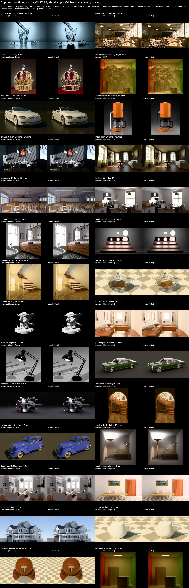

# Research scenes plan: what the glTF research set needs of the renderer

The glTF research set (`resources/test-assets/gltf-research-scenes`, 28 scenes, mostly Bitterli's Tungsten scenes converted from pbrt-v4) ships what most test assets don't: each scene's `conversion.yaml` says how every pbrt material and light was mapped to glTF and what was approximated or lost, and a path traced render of the converted glTF (Blender Cycles; cornell-caustic's is pbrt's) comes with the conditions it was made in (`reference_render`: camera, size, environment and strength, exposure multiplier, Khronos PBR Neutral). So the renderer can be held against a ground truth of the very file it loads. The goal is to support what these scenes use as far as a real-time renderer can, at 60 Hz on modern hardware with hardware ray tracing. Status: steps 0 to 10 are done; step 6's own design is open and step 8 has known leftovers, and what remains of the difference is mostly the indirect lighting's own approximations, which the indirect lighting notes and `docs/backlog.md` keep. The follow-up on what was seen in the client is in `docs/research-scenes-review-plan.md`.

## What the scenes use

The material extensions pbrt's dielectrics, coats and volumes map to (`KHR_materials_specular`, `_transmission`, `_ior`, `_clearcoat`, `_volume`, `_dispersion`, `_emissive_strength`; the extended files carry them, the core files leave them out), emissive meshes, directional lights, and panoramas or uniform colors as environments (about half the scenes have none). Lost in the conversion, and so in the references too: displacement, diffuse transmission, crown's depth of field, exact spectral IORs, pbrt's bump mapping.

## The comparison

`scripts/researchcompare.ps1 -Preset <preset>` renders each scene headless at its reference's size from the file's camera, 1500 frames, repeatable, in its reference's conditions: the reference's panorama at its strength (or no environment where it had none, so that neither the sky nor its sun lights the scene), the set's panorama orientation, a manual exposure of the reference's multiplier, PBR Neutral, and the client's ground plane, glare, motion blur and grain off. Since step 1 the client reads these conditions from the file itself (`ReadModelConditions`, flat keys of `conversion.yaml` beside the model; docs/notes/assets.md, "A model's own conditions"), so the script sets almost none of them.

It writes a sheet per scene (reference, render, their differences amplified 16 times), an overview, and a table with the scenes most unlike their references first, by two measures: the mean |log2| of the two luminances blurred over 8 pixels (the lighting, not its noise or edges) and the ratio of their means (the light overall). Nothing fails on a measure: a path tracer's reference maps what is approximated, it isn't a regression check. Options: `-Only`, `-Set name=value`, `-Units scene=unit`, `-Kind core`, `-Timings` (frame time and the costliest passes' gpu times at the target), `-Chart <path>` (the overview as a JPEG).

Two scenes are also held by checks in `scripts/visualtest.ps1`, which CI runs on lavapipe: cornell-box (its emitter and the indirect bounces) and material-testball (a panorama, the coat and the metals), each against its reference scaled to the capture's size (`imagecompare --fit`), with thresholds a few times what lavapipe measures so that they fail on a regression, not on what the renderer approximates. Their reference files are fetched one by one (`research-files.txt`).

## The target

60 Hz (16.7 ms a frame) at 2560x1440 with balanced upscaling on a high-end desktop GPU; hardware scaling for slower GPUs is revisited later. Each step states what it adds at that size, at the research scenes' reference poses and the performance plan's benchmark poses (docs/performance-plan.md); a step over its budget is made cheaper or set aside.

## Where it stands

Every scene is closer to its reference than at the baseline. glass-of-water, the worst at the baseline, is the one scene over 60 Hz (its glass, water and ice in Main Transmissive). Some scenes are now slightly brighter than their references, and vintage-car's single sheet windows refract as solids under the set's conditions.

## How it is judged (every step)

The comparison for every scene (none worse than the runs' noise, the sheets by eye), the validated quick tier and the regression sets of the step's area, `scripts/visualtest.ps1`, and performance as the performance plan measures it.

## The gaps

The steps cite these codes.

- A1 to A4, the scene's conditions: the conditions travel with the file; the panorama's orientation is the set's; a model with outdoor lights or its own panorama turns the physical sky off; a mirrored camera renders mirrored.
- B1 to B5, bugs the comparison found: glass black when traced (a traced hit took no light from emissive meshes, which light these scenes); volume absorption by the thickness factor where the refraction is traced; a small panorama's mips; emission past the half float's range; the brightest light's highlight dark in its center.
- C1 to C5, what the renderer approximates: the area lights' highlights, rough glass, caustics from emissive surfaces, gems, and units (the set's are pbrt's, read as meters).

## The steps

- 0. The baseline: done. The script and the first table of both measures for all scenes, with the runs' noise.
- 1. The conditions with the file, the mirrored camera, the small panorama (A1 to A4, B3): done. `ReadModelConditions`, the set's panorama orientation, a model's directional light replaces the sky (`SPEEDO_SKY_WITH_MODEL_LIGHTS=1` keeps it), a mirrored camera drawn mirrored, small panoramas scaled up.
- 2. The emitters' light at traced hits (B1): done. `TracedHitRadiance`: diffuse from the screen's gathered light or the hit's voxel, specular from a light sample where it matters. Transmission without a volume is a solid where the set's conditions apply (`SPEEDO_SOLID_TRANSMISSION`).
- 3. Absorption over the traced path (B2): done. `GlassPathStep` absorbs along the path's length; the untraced lookup and the caustics' photons use the thickness.
- 4. The emitters' highlights on glossy surfaces (C1, glossy): done. `TracedGlossyEmitters`: a light sample beside the glossy ray, combined by the balance heuristic (`EmitterDensity`); this also removed B5.
- 5. The emitters' highlights on rough surfaces (C1, rough): done. `EmitterSpecular` takes the points neighbouring traced pixels found, accumulated over frames (`EmitterSpecularOverFrames`); with step 4, slightly over the 1 ms budget in the heaviest emissive scene (docs/notes/rendering.md).
- 6. Glossy glass (C2): done, kept simple. The traced refraction's ray is of the surface's GGX lobe (`TransmittedLobeRay`), averaged by the upscaler. Open: the original design (the nearest glass layer filtered and accumulated by Reflection passes of its own), for where frosted glass fills the view.
- 7. Emission's range (B4): nothing to build. The main pass already clamps its color to 65000 (`MainColor`) and cornell-caustic's light draws cleanly.
- 8. Caustics from the emitters (C3): done. `ComputeEmitterCaustics` (docs/notes/rendering.md, "The emitters' caustics"): photons from the emitters through glass into screen space and world cells, accumulated over frames; the diffuse's shadow rays stop at solid glass while traced. Left: the photons' light in the indirect lighting's voxels, what is off the screen, and highlights through glass.
- 9. Gems (C4): measured, nothing to build. Crown's remaining difference is the gold's many-bounce reflections of itself and the panels.
- 10. A few comparisons in CI: done. The two visualtest checks above.
